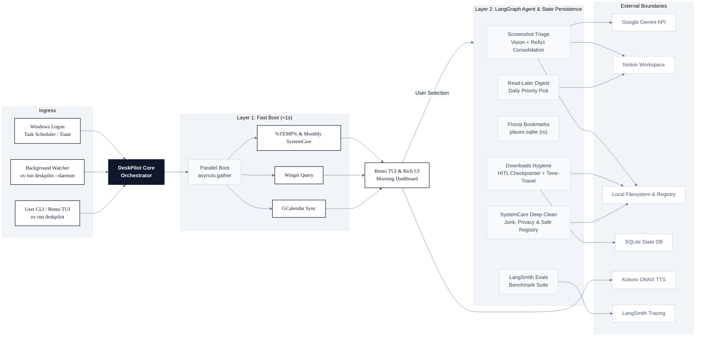

# DeskPilot

> **Your personal morning routine on autopilot.**

Every time you log into your computer, DeskPilot cleans up system clutter, checks for software updates, and speaks your daily agenda—all in under a second.

When you're ready, trigger on-demand AI agents to triage scattered screenshots into Notion, safely organize messy downloads with review checkpoints, deep-clean system junk, and audit your browser bookmarks without lifting a finger.

---

## Why DeskPilot?

- **Starts in Under 1 Second**: No waiting for heavy AI models to load on boot. Local hygiene tasks run concurrently in milliseconds, complete with an optional spoken morning briefing.
- **AI Only When You Want It**: Intelligent multi-modal agents (screenshot categorization, downloads cleanup, reading digest) run strictly on demand when you pick them from the menu.
- **3-in-1 SystemCare Deep Clean**: Safely purges gigabytes of stale developer caches (npm, uv, pip), browser junk, privacy traces, and broken registry references—automatically triggered every 30 days or on demand.
- **Zero Risk to Your Files**: Destructive actions require your explicit green light. Screenshots are only deleted locally after Notion confirms they are safely saved, and downloads are never moved or deleted without terminal confirmation.
- **Ready Out of the Box**: You do not need any API keys or external accounts to clean `%TEMP%` files, inspect software updates, or use the morning terminal dashboard.

---

## Table of Contents

- [Terminal Dashboard Preview](#terminal-dashboard-preview)
- [Architecture Overview](#architecture-overview)
- [Technology Stack](#technology-stack)
- [Project Structure](#project-structure)
- [Core Features](#core-features)
- [Prerequisites](#prerequisites)
- [Quickstart Guide](#quickstart-guide)
- [Service Integrations Setup](#service-integrations-setup)
- [Windows Startup Integration](#windows-startup-integration)
- [Configuration Reference](#configuration-reference)
- [Safety & Privacy Guarantees](#safety--privacy-guarantees)
- [Development & Testing](#development--testing)

---

## Terminal Dashboard Preview

DeskPilot launches with an interactive **Bento TUI dashboard** (System Hygiene, Package Updates, and Today's Agenda) with live LangSmith diagnostics and an intuitive action dock:


and here is the Notification Toast that greets you on Windows logon:


> [!TIP]
> **On-Demand Floorp View**: When you select option `[3]`, the bookmark auditor runs on demand without slowing down your initial boot. When bookmarks data is present, the dashboard seamlessly expands to a 2x2 grid displaying the Floorp Bookmarks panel alongside System Hygiene, Winget, and Calendar.

---

## Architecture Overview

DeskPilot utilizes a **dual-layer architecture**:

1. **Layer 1: Sub-Second Boot & Fast Hygiene Layer** &mdash; Runs fast, local hygiene tasks concurrently using `asyncio.gather`. Does not import heavy LLM or LangGraph libraries on startup to ensure instant terminal boot times (<1s). Includes a 30-day automatic cadence for deep system care.
2. **Layer 2: Autonomous Agent & State Persistence Layer** &mdash; Dynamically loaded only on demand when triggered by user selection or the background watcher daemon. Powered by LangGraph state machines, multi-modal LLMs (Google Gemini Vision), ReAct consolidation agents with adversarial schema interceptors, and native checkpointers (`MemorySaver` / SQLite persistence) enabling **Human-in-the-Loop (HITL) pause breakpoints, state inspection, and time-travel resumption**.

<p align="center">
  
</p>

<details>
<summary><b>View Text-Based Flowchart Representation</b></summary>



</details>

---

## Technology Stack

- **Runtime & Tooling:** Python 3.12+ managed with [Astral `uv`](https://docs.astral.sh/uv/)
- **Agent Orchestration:** LangGraph (StateGraph, `MemorySaver`, HITL `interrupt_before`) & LangChain Core
- **LLM & Multi-Modal Vision:** Google Gemini Vision via `google-genai` / `langchain-google-genai`
- **Voice Synthesis:** Kokoro-ONNX neural TTS engine with local ONNX runtime & Windows audio device routing
- **Terminal Presentation:** Modern [Textual](https://github.com/Textualize/textual) Bento TUI & [Rich](https://github.com/Textualize/rich) (`Console`, `Live`, `Table`, `Panel`, `Grid`)
- **Observability:** LangSmith (OTEL trace exports, dataset benchmarks, evaluators)
- **Integrations:** Google Calendar API, Notion API (`@notionhq/client` with dynamic schema introspection), Windows Package Manager (`winget`), Floorp browser (`places.sqlite` immutable reader)

---

## Project Structure

```text
multi-agent-orchestrator-pers1/
├── deskpilot/
│   ├── agent_tasks/        # Layer 2 on-demand LangGraph agents (screenshots, downloads HITL)
│   ├── boot_tasks/         # Layer 1 sub-second parallel hygiene (temp cleaner, winget, calendar)
│   ├── evals/              # LangSmith deterministic benchmark datasets and evaluators
│   ├── storage/            # Dual-layer SQLite persistence & thread checkpoint storage
│   ├── ui/                 # Textual Bento TUI, Rich dashboard layouts, and interactive renderers
│   ├── daemon.py           # Autonomous background watcher for screenshot and download cadences
│   ├── voice.py            # Kokoro-ONNX neural TTS briefing and audio chimes
│   ├── config.py           # Pydantic settings models and YAML configuration loader
│   └── cli.py              # Application entrypoint, CLI arguments, and action menu
├── scripts/                # Windows PowerShell logon registration automation
├── tests/                  # Unit, agent persistence, and integration test suites
├── config.yaml             # Core user configuration file
└── .env.example            # Environment variables template
```

---

## Core Features

### Fast Boot Sequence (Layer 1)
- **Windows `%TEMP%` Cleaner**: Recursively purges temporary files older than 24 hours while safely tolerating locked Windows process handles.
- **Automatic 30-Day Cadence**: Silently runs deep junk and privacy maintenance every 30 days during boot to keep your machine fast without manual reminders.
- **Winget Package Updates**: Queries Windows Package Manager for available software upgrades with timeout protection and custom exclusions (`AdvancedSystemCare`, `RevoUninstallerPro`, `DriverBooster`).
- **Google Calendar Agenda**: Fetches your daily schedule, displaying all-day events, meeting times, Google Meet locations, and token expiry warnings.
- **Windows Toast & Protocol Ingress**: Emits lightweight Windows notifications on boot with action buttons and custom `deskpilot://` protocol handler registration for instant one-click terminal activation.
- **Spoken Morning Briefing (Kokoro-ONNX)**: Listens like a personal assistant. Kokoro-ONNX speaks your schedule and hygiene summary in the background through your speakers or headset while your terminal stays snappy.

### Intelligent Autonomous Agents & Cleaners (Layer 2)
- **Smart Screenshot Sorter (Option 1)**: Reads cluttered screenshots using Gemini Vision, identifies diagrams, work notes, or research items, and routes them to dedicated Notion destinations. It strictly preserves unapproved items locally and only cleans up screenshots that are verified as safely synced in Notion.
- **Safe Downloads Cleaner with HITL Review (Option 2)**: Classifies downloads into installers, archives, code, documents, media, and images. Automatically flags stale installers (>30 days old) and unorganized files, then pauses at an explicit confirmation checkpoint so you can review and approve every change before anything moves on disk.
- **Safe Floorp Bookmarks Auditor (Option 3)**: Finds duplicate bookmarks and strips noisy tracking tags (like UTM referral links). Connects in read-only immutable mode so you can audit bookmarks even while your browser is actively open.
- **Interactive Winget Package Upgrade (Option 4)**: Interactive package upgrade CLI helper that automatically respects your configured exclusions (`ignore_packages`).
- **Notion Read-Later Digest (Option 5)**: Curates daily unread reading recommendations from your Notion reading list ("The Read Later List"), prioritizing critical tags and oldest entries with one-click status updates.
- **SystemCare Deep Clean (Option 6)**: 3-in-1 maintenance suite that sweeps developer/app junk caches (npm, uv, pip, shaders, browsers), clears Windows privacy traces (Jump Lists, recent documents), and safely removes dead registry run keys without touching system associations.
- **Autonomous Watcher Daemon (`--daemon`)**: Background service that monitors your screenshot volume and downloads directory, automatically prompting or executing triage according to your configured thresholds.
- **LangSmith Benchmark Suite (`--eval`)**: Deterministic evaluation harness testing agent safety, categorization accuracy, and human-in-the-loop decisions in a safe isolated temporary directory sandbox without touching real user files.

---

## Prerequisites

- **Operating System**: Windows 10 / 11 (64-bit)
- **Python**: Python 3.12 or newer (tested with 3.12 and 3.14)
- **Package Manager**: [`uv`](https://docs.astral.sh/uv/) (Astral's ultra-fast Python package manager)
- **PowerShell**: Windows PowerShell 5.1+ or PowerShell 7+ (for startup integration scripts)

---

## Quickstart Guide

> [!NOTE]
> **No API keys needed for the basic morning dashboard.**
> You can run `uv run deskpilot` immediately to clean `%TEMP%` files and inspect Winget updates. Google Calendar, Notion, and Gemini Vision can be connected whenever you're ready.

### 1. Install `uv`
If you haven't installed `uv` yet, run in PowerShell:
```powershell
powershell -ExecutionPolicy ByPass -c "irm https://astral.sh/uv/install.ps1 | iex"
```

### 2. Clone & Setup Project
```powershell
git clone https://github.com/your-username/deskpilot.git
cd deskpilot

# Sync dependencies and create isolated virtual environment
uv sync
```

### 3. Configure Settings (Optional)
Copy `.env.example` to `.env`:
```powershell
Copy-Item .env.example .env
```
Edit `.env` and `config.yaml` to configure your API tokens and directories when you want to enable Calendar, Notion, or Gemini features (see [Configuration Reference](#configuration-reference)).

### 4. Run DeskPilot
```powershell
# Interactive Command Center (Launches modern Bento TUI by default)
uv run deskpilot

# Classic Terminal Dashboard (Bypasses Bento TUI)
uv run deskpilot --no-tui

# Silent logon boot run (Executes Layer 1 + background voice, then exits)
uv run deskpilot --startup

# Run autonomous background watcher daemon
uv run deskpilot --daemon

# Display SQLite cross-thread state persistence and checkpointer statistics
uv run deskpilot --storage-status

# Run LangSmith connectivity diagnostic
uv run deskpilot --check-tracing

# Run agent benchmark evaluations locally in isolated sandbox
uv run deskpilot --eval --local-only

# Run agent benchmark evaluations for downloads and upload results to LangSmith
uv run deskpilot --eval --eval-target downloads
```

---

## Service Integrations Setup

### 1. Google Calendar Integration
1. Go to the [Google Cloud Console](https://console.cloud.google.com/).
2. Create a new project (e.g. `DeskPilot`).
3. Enable the **Google Calendar API** under **APIs & Services > Library**.
4. Go to **APIs & Services > Credentials** and click **Create Credentials > OAuth client ID**.
5. Choose **Desktop app** as the Application type.
6. Download the client secret JSON file and save it as `credentials.json` in the root of the DeskPilot repository.
7. On first run, DeskPilot will prompt you once to authorize calendar access in your browser and automatically save `token.json`.

### 2. Notion API Integration
DeskPilot connects with Notion to power both the Screenshot Triage Agent and the Read-Later Newsfeed Agent.

1. Visit [Notion My Integrations](https://www.notion.so/profile/integrations).
2. Click **New integration**, name it `DeskPilot`, and select your workspace.
3. Copy the **Internal Integration Secret** and paste it into `.env` as `NOTION_TOKEN`.
4. Open the target Notion databases or pages you wish to sync with DeskPilot, click **... > Connect to**, and select your `DeskPilot` integration.

#### "The Read Later List" (Read-Later Newsfeed)
- Connect your reading list database to DeskPilot and set `read_later_database_id` in `config.yaml` (or `NOTION_READ_LATER_DATABASE_ID` in `.env`).
- Menu Option `[5]` analyzes your unread articles from "The Read Later List", prioritizes high-value tags (e.g., `#critical`, `#architecture`) and oldest entries, presents daily picks in your terminal, and lets you mark them as read in Notion.

#### Multi-Destination Screenshot Routing
DeskPilot's Screenshot Triage Agent uses Gemini Vision to classify captured images and route them to dedicated Notion destinations:
- **WorkNote Database** (`work_notes_database_id` / `NOTION_WORK_NOTES_DATABASE_ID`): Receives `WORK_NOTES` screenshots.
- **Due Diligence Questionnaire Page** (`due_diligence_page_id` / `NOTION_DUE_DILIGENCE_PAGE_ID`): Receives `DUE_DILIGENCE` screenshots, appending formatted callout blocks.
- **Brainstorm Session Page** (`brainstorm_page_id` / `NOTION_BRAINSTORM_PAGE_ID`): Receives `BRAINSTORM` screenshots, appending formatted callout blocks.
- **Local Keep (`LOCAL_KEEP`)**: Preserved strictly in local storage without syncing to Notion or deleting.
- *(Fallback)*: `parent_page_id` / `NOTION_PARENT_PAGE_ID` is retained for backwards compatibility when individual destination IDs are not configured.

#### Dynamic Notion Schema Introspection for WorkNote
When syncing to the **WorkNote** database, DeskPilot never relies on hardcoded property names. Instead, it dynamically introspects your database schema via `client.databases.retrieve`:
- **Title Property**: Detects the database title property regardless of whether it is named `Name`, `Title`, or `Topic`.
- **Category / Tag Property**: Inspects property types for `select` or `multi_select` fields (matching `Tags`, `Category`, `Topic`, `Area`, etc.) and formats the payload with appropriate tag arrays or objects.
- **Date Property**: Detects `date` fields (matching `Date`, `Created`, `Date Created`, etc.) and automatically assigns the current UTC timestamp.
- **Content Blocks**: Appends structured Notion child blocks including a heading with the note title, category badge, AI rationale, and source image filename.
- **Schema Caching**: Results are cached in-memory per run to eliminate redundant Notion API roundtrips.

### 3. Google Gemini Vision API
1. Get a Gemini API key from [Google AI Studio](https://aistudio.google.com/).
2. Add the key to `.env`:
   ```dotenv
   GEMINI_API_KEY=AIzaSy...
   ```

### 4. Neural Voice Briefings (Kokoro-ONNX)
DeskPilot includes an on-device neural text-to-speech engine powered by Kokoro-ONNX.
- **Automatic Caching**: Model weights (`kokoro-v1.0.onnx`) and voice packs (`voices-v1.0.bin`, ~27MB) download automatically on first run to `~/.cache/kokoro/` (or configured directory).
- **Audio Output Selection**: Specify a dedicated audio device (`device: "Headset"` or `device: "Speakers"`) in `config.yaml` or leave as `null` to use the Windows system default.
- **Voice Customization**: Choose from 4 built-in neural voices (`af_bella`, `af_sarah`, `am_adam`, `am_michael`) and configure playback speed in `config.yaml`.

### 5. Floorp Browser Bookmarks (On-Demand)
- Floorp bookmark auditing is executed **on-demand** via Action Menu option `[3]`, completely decoupled from the boot sequence for sub-second startup speed.
- DeskPilot automatically searches `%APPDATA%\Floorp\Profiles\*.default-release\places.sqlite`.
- If using a custom Floorp installation or profile, set `floorp.profile_path` in `config.yaml`.
- The connection uses SQLite's read-only immutable flag (`?immutable=1&mode=ro`), allowing you to audit bookmarks even while Floorp is open without lock contention or write hazards.

### 6. Winget Package Exclusions
To keep your morning boot dashboard clean and avoid repetitive prompts for software you manage separately or keep pinned, configure `winget.ignore_packages` in `config.yaml`:
- By default, DeskPilot ignores:
  - `AdvancedSystemCare`
  - `RevoUninstallerPro`
  - `DriverBooster`
- Exclusions perform case-insensitive substring matching against both package name and package ID.
- Excluded packages are filtered out from both the morning update notification panel and the interactive winget upgrade helper (Option `[4]`).

---

## Windows Startup Integration

DeskPilot includes PowerShell automation scripts in the `scripts/` directory to automatically launch the morning command center whenever you log into Windows.

### Register Startup Task
Run the registration script from PowerShell:
```powershell
# Register silent logon startup task (runs boot hygiene & voice in background)
.\scripts\register_startup.ps1

# Register task with elevated privileges (Run as Administrator)
.\scripts\register_startup.ps1 -RunAsAdmin

# Launch interactive terminal window directly on logon instead of silent background
.\scripts\register_startup.ps1 -StartupFlag:$false

# Use Windows Startup folder shortcut instead of Task Scheduler
.\scripts\register_startup.ps1 -Method StartupFolder

# Overwrite existing registration
.\scripts\register_startup.ps1 -Force
```

### Unregister Startup Task
To remove DeskPilot from Windows startup at any time:
```powershell
.\scripts\unregister_startup.ps1
```

---

## Configuration Reference

### Environment Variables (`.env`)
Environment variables override settings loaded from `config.yaml`:

| Variable | Description |
| :--- | :--- |
| `NOTION_TOKEN` | Notion Internal Integration Secret |
| `NOTION_PARENT_PAGE_ID` | Notion Page ID for screenshot notes sync (fallback) |
| `NOTION_READ_LATER_DATABASE_ID` | Notion Database ID for "The Read Later List" |
| `NOTION_WORK_NOTES_DATABASE_ID` | Notion Database ID for "WorkNote" entries (dynamic schema introspection) |
| `NOTION_DUE_DILIGENCE_PAGE_ID` | Notion Page ID for "Due Diligence Questionnaire" screenshots |
| `NOTION_BRAINSTORM_PAGE_ID` | Notion Page ID for "Brainstorm Session" screenshots |
| `GEMINI_API_KEY` | Google Gemini API key for vision classification |
| `LANGSMITH_TRACING` | Set to `true` to enable LangSmith workflow tracing (`LANGCHAIN_TRACING_V2` also supported) |
| `LANGSMITH_API_KEY` | LangSmith API Key (`LANGCHAIN_API_KEY` also supported) |
| `LANGSMITH_PROJECT` | LangSmith project name (default: `DeskPilot`) |

---

## Safety & Privacy Guarantees

- **Human-in-the-Loop (HITL) Checkpointer Breakpoints**: File operations are gated behind explicit LangGraph interruption boundaries (`interrupt_before=["execute_actions"]`). State snapshots can be inspected, audited, and adjusted before resuming (`resume_downloads_hygiene`), guaranteeing zero disk modifications without authorization.
- **Safe Registry Pruning**: SystemCare deep clean prunes only broken MuiCache application entries and dead startup references. It never modifies system CLSIDs, file associations, or protected Windows keys.
- **Adversarial Schema Validation & Self-Correction**: Notion tool execution is guarded by strict Pydantic models. Malformed arguments or missing UUIDs trigger structured feedback for the agent to self-correct before any network mutation occurs.
- **Multi-Destination Screenshot Routing & Zero Unsynced Deletion**: The Screenshot Triage Agent **only** removes local screenshots that have been verified as successfully created and confirmed in their designated Notion destination (`is_synced == True`). Images classified as `LOCAL_KEEP` or unapproved clusters are strictly preserved locally and never deleted.
- **Read-Only SQLite Locking**: The Floorp auditor connects to `places.sqlite` using `immutable=1&mode=ro` on demand. It never locks the database, allowing you to use your browser freely during audits.
- **Winget Exclusion Protection**: Pinned or blacklisted software packages (`AdvancedSystemCare`, `RevoUninstallerPro`, `DriverBooster`) are automatically filtered out from upgrade lists to prevent unwanted bulk modifications.
- **Local-First Fast Boot**: All Layer 1 boot checks execute strictly locally on your machine without making heavy network calls or loading LLM libraries.

---

## Development & Testing

DeskPilot is developed following strict Test-Driven Development (TDD) principles.

```powershell
# Run the complete test suite
uv run pytest -v

# Run fast Layer 1 boot hygiene tests
uv run pytest tests/test_system_hygiene.py

# Run LangGraph persistence and state checkpointer tests
uv run pytest tests/test_screenshot_persistence.py tests/test_storage.py

# Run benchmark evaluations locally
uv run deskpilot --eval --local-only
```
