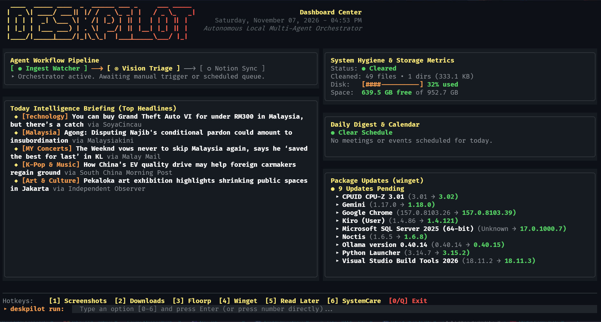
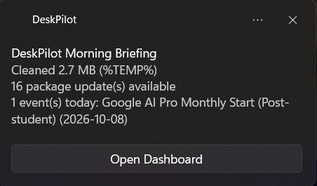
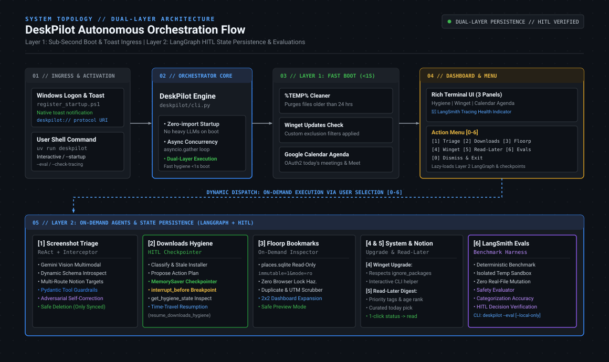

# DeskPilot

> Your Windows morning routine on autopilot.

Every time you log in, DeskPilot cleans temporary junk, purges standby RAM, checks for app updates, and speaks your daily agenda—in under a second.

When you need it, run on-demand agents to triage screenshots to Notion, organize downloads with interactive review checkpoints, and audit browser bookmarks.

---

## Highlights

- **Instant Startup (<1s):** Local boot tasks run concurrently without loading heavy LLM packages. Includes an optional spoken audio briefing via Kokoro-ONNX.
- **Native Windows Memory Care:** RAMMap-style standby list purging, working set trimming, and modified page flushing—via CLI (`--clear-ram`) or background daemon game detection.
- **On-Demand Intelligence:** Multi-modal agents (Gemini Vision screenshot triage, downloads organizer, reading digest) run only when selected from the menu.
- **Zero Risk to Files:** Destructive actions require confirmation. Screenshots delete locally only after Notion confirms receipt; downloads never move without approval.
- **Works Offline / No Keys Needed:** Basic cleanup, memory optimization, update checking, and the terminal UI require zero API keys. Connect Notion, Google Calendar, or Gemini when you are ready.

---

## Preview

DeskPilot launches with an interactive **Bento TUI dashboard** (System Hygiene, Package Updates, Today's Agenda, and Floorp Bookmarks) alongside logon toast notifications:

<p align="center">
  
  
</p>

---

## Architecture

DeskPilot uses a dual-layer design to separate sub-second boot hygiene from on-demand agentic workflows:

<p align="center">
  
</p>

1. **Layer 1: Sub-Second Boot & Hygiene:** Runs fast local tasks concurrently via `asyncio.gather` (temp cleaner, memory optimization hook, winget updates, calendar sync, audio briefing). No LLM imports on startup.
2. **Layer 2: On-Demand LangGraph Agents:** Lazy-loaded state machines with Google Gemini Vision, SQLite persistence, and Human-in-the-Loop (HITL) review checkpoints.

---

## Core Features

| Feature | Layer | Description |
| :--- | :---: | :--- |
| **%TEMP% & Cache Cleanup** | 1 | Purges temp files older than 24h; runs deep junk sweep every 30 days. |
| **RAM & Standby List Purge** | 1 | Trims process working sets, flushes modified pages, and purges Windows Standby RAM (`--clear-ram` or auto-daemon). |
| **Winget Update Check** | 1 | Checks for app updates with custom exclusion filters (`ignore_packages`). |
| **Google Calendar Agenda** | 1 | Displays today's events, meeting links, and token status. |
| **Spoken Briefing** | 1 | Reads your day's summary via on-device Kokoro-ONNX neural TTS. |
| **Screenshot Sorter** | 2 | Gemini Vision categorizes screenshots and routes them to Notion (Work notes, Due Diligence, Brainstorm). Deletes locally only after sync verification. |
| **Downloads Hygiene** | 2 | Groups downloads into categories, flags stale installers (>30d), and pauses for review before moving files. |
| **Floorp Bookmarks Audit** | 2 | Scans for duplicates and strips tracker params in read-only mode (`immutable=1&mode=ro`). |
| **Read-Later Digest** | 2 | Pulls unread articles from your Notion reading list, sorted by priority. |
| **SystemCare Deep Clean** | 2 | Sweeps developer caches (npm, uv, pip), privacy traces, and dead registry entries. |

---

## Quickstart

### Prerequisites
- Windows 10 / 11 (64-bit)
- Python 3.12+
- [`uv`](https://docs.astral.sh/uv/)

### 1. Install & Setup

```powershell
# Install uv if needed
powershell -ExecutionPolicy ByPass -c "irm https://astral.sh/uv/install.ps1 | iex"

# Clone and install dependencies
git clone https://github.com/your-username/deskpilot.git
cd deskpilot
uv sync
```

### 2. Configure (Optional)

```powershell
Copy-Item .env.example .env
```

Configure `.env` or `config.yaml` to connect services:

| Key | Description |
| :--- | :--- |
| `GEMINI_API_KEY` | Google Gemini API key for screenshot analysis |
| `NOTION_TOKEN` | Notion Internal Integration Secret |
| `NOTION_WORK_NOTES_DATABASE_ID` | Notion Database ID for work note entries |
| `NOTION_READ_LATER_DATABASE_ID` | Notion Database ID for reading list |
| `NOTION_DUE_DILIGENCE_PAGE_ID` | Notion Page ID for due diligence screenshots |
| `NOTION_BRAINSTORM_PAGE_ID` | Notion Page ID for brainstorm screenshots |
| `LANGSMITH_API_KEY` | (Optional) LangSmith API key for trace collection |

For **Google Calendar**, place your OAuth desktop client `credentials.json` in the project root. DeskPilot prompts once on initial run to generate `token.json`.

### 3. Usage

```powershell
# Launch interactive Bento TUI
uv run deskpilot

# Run classic terminal interface
uv run deskpilot --no-tui

# Purge Windows Standby List & trim working sets on demand
uv run deskpilot --clear-ram

# Silent logon boot run (Layer 1 + voice, then exits)
uv run deskpilot --startup

# Start background watcher daemon (handles downloads & auto gaming memory purge)
uv run deskpilot --daemon

# Run test evaluations locally
uv run deskpilot --eval --local-only
```

---

## Windows Startup Setup

Automate DeskPilot to run on user login using the bundled PowerShell scripts:

```powershell
# Register silent background task on logon
.\scripts\register_startup.ps1

# Register interactive terminal window on logon
.\scripts\register_startup.ps1 -StartupFlag:$false

# Remove from Windows startup
.\scripts\unregister_startup.ps1
```

---

## Safety Guarantees

- **HITL Checkpoints:** File modifications are gated behind LangGraph interruption points (`interrupt_before=["execute_actions"]`). No files move or delete without explicit confirmation.
- **Sync-Gated Screenshot Cleanup:** Screenshots are deleted locally only after Notion confirms the sync was successful.
- **Read-Only Browser Access:** Connects to Floorp SQLite database with `immutable=1&mode=ro`, preventing locks and data corruption while the browser is open.
- **Safe Registry Maintenance:** SystemCare cleans only dead application references (MuiCache) and invalid startup entries. It does not touch CLSIDs or protected keys.

---

## Development & Testing

```powershell
# Run entire test suite
uv run pytest -v

# Test boot tasks (hygiene & memory)
uv run pytest tests/test_system_hygiene.py tests/test_memory_manager.py

# Test agent state persistence
uv run pytest tests/test_screenshot_persistence.py tests/test_storage.py
```
